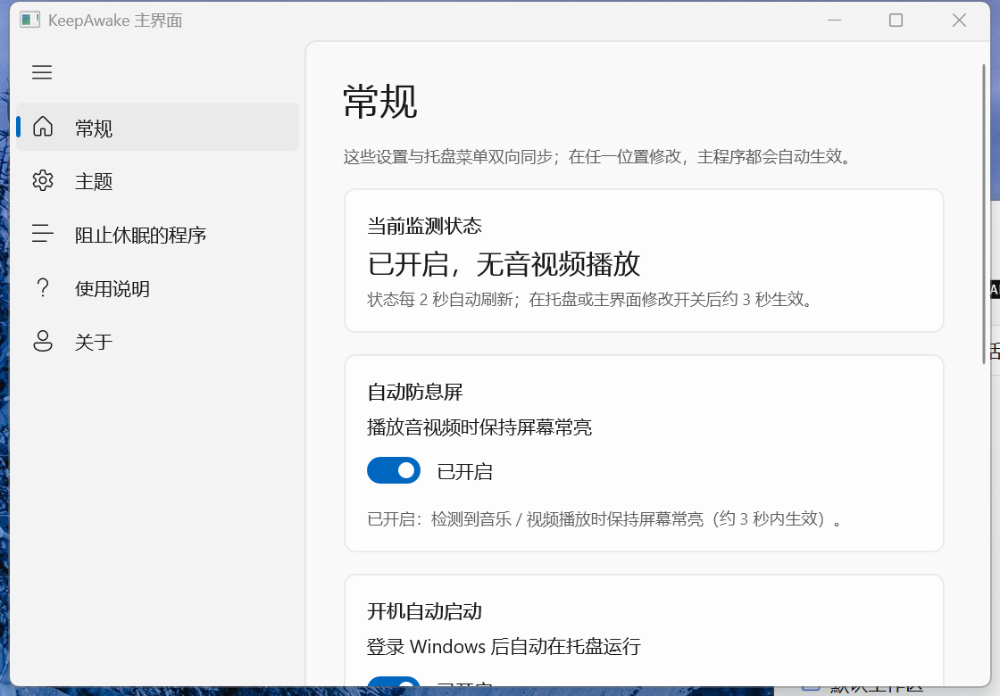
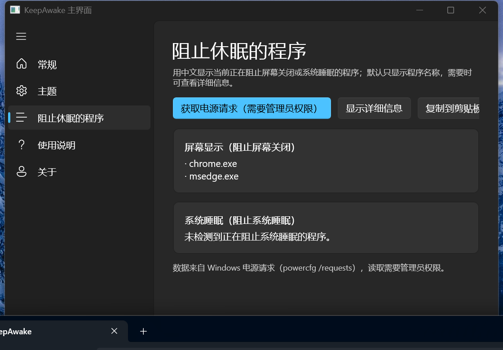
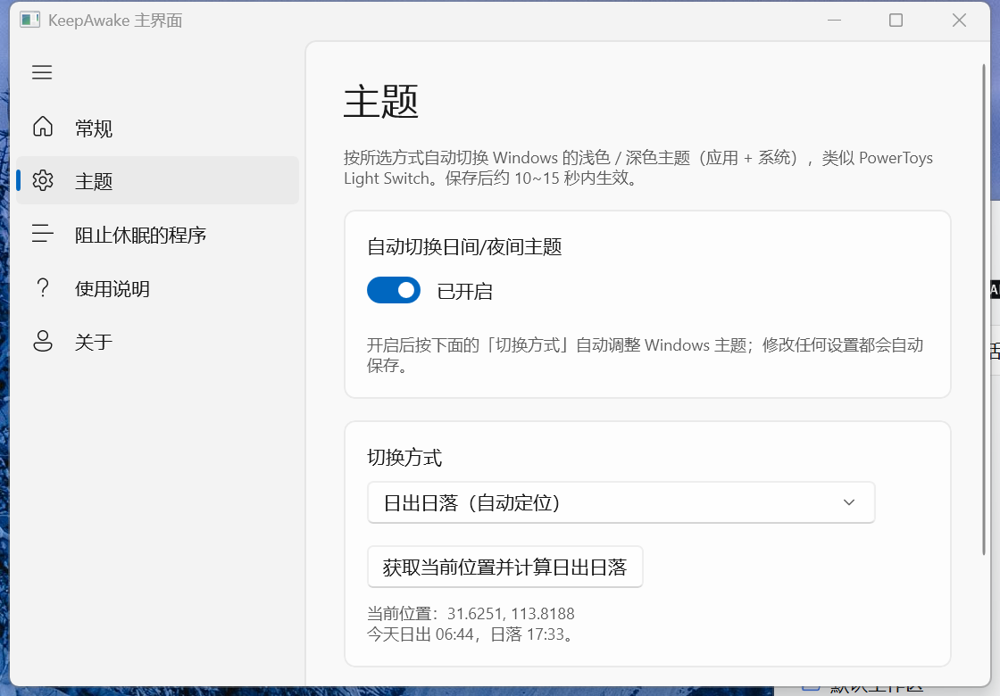

# ScreenStay —— Windows 托盘「智能保持屏幕常亮」工具

一个约 80 KB 的单文件 Windows 小工具（另附约 37 MB 的 WinUI 3 主界面）：**检测到音乐 / 视频正在播放时，自动阻止屏幕关闭与系统空闲睡眠；没有播放时，把熄屏和睡眠交还给 Windows 电源管理。** 主界面支持按时间 / 日出日落 / 夜间模式自动切换日间 / 夜间主题、查看当前有哪些程序在阻止屏幕休眠、开关开机自启和弹窗提醒。托盘图标常驻右下角，**单击**打开主界面，右键只有 4 项快捷操作。


## 功能

- **智能保持常亮**：开启后每 3 秒检测一次系统音频会话（WASAPI），判断是否有音乐 / 视频正在播放。
  - 检测到播放：阻止屏幕关闭与系统空闲睡眠；如果屏幕已经关闭，还会立即点亮。
  - 没有播放：撤销唤醒请求，恢复 Windows 默认的熄屏 / 睡眠策略。
  - 静音播放同样能识别（音频会话仍为 Active），所以静音看视频也会保持常亮。
  - 播放停止后还会再保持 10 秒，避免切歌 / 缓冲间隙反复切换电源请求。
- **三态托盘图标（纯显示器）**：红色（已开启，检测到播放）、绿色（已开启，无播放 / 缓冲中）、灰色（未开启）。
- **查看阻止休眠的程序**：用中文列出当前正在阻止屏幕关闭 / 系统睡眠的程序（默认只显示程序名，可一键展开原始详细信息）。页面使用 **WinUI 3**（Fluent Design / Mica），支持深色模式与高 DPI。该数据需要管理员权限，点击按钮后确认 UAC 提示即可查看。
- **自动切换日间 / 夜间主题**：按自定义时间 / 日出日落 / Windows 夜间模式自动切换 Windows 的浅色 / 深色主题（应用 + 系统，类似 PowerToys Light Switch / Auto Dark Mode），可在主界面「主题」页调整。
- **关闭 Windows 弹窗提醒**：不想看到启动、开关、自启等气泡通知时，可以在主界面「常规」页关闭，设置会记忆。
- **右键菜单**：当前状态、自动防息屏开关、打开主页面、退出（其余设置在主界面中）。
- **主界面**：单击托盘图标打开 WinUI 3 主界面，左侧导航为「常规 / 主题 / 阻止休眠的程序 / 使用说明 / 关于」；**双击托盘图标可快速开关自动防息屏**。
- **开机自动启动**：写入当前用户启动项（`HKEY_CURRENT_USER\...\Run`），**不需要管理员权限**，也不修改系统电源计划。
- **状态记忆**：记住上次的开关状态，下次启动（包括开机自启）自动恢复。
- **单实例**：重复运行 exe 不会出现多个图标，只会激活主界面。
- 退出程序时自动撤销唤醒请求，不会在后台「偷偷」保持唤醒。

## 安装与卸载（推荐给普通用户）

- 双击 `dist\ScreenStay-Setup-1.5.2.exe`，按向导安装（默认安装到 `%LOCALAPPDATA%\Programs\ScreenStay`）。
- 安装时可选择：创建桌面快捷方式、开机自动启动、安装完成后启动 ScreenStay。
- 安装完成后，可在 **设置 → 应用 → 已安装的应用**（或控制面板「程序和功能」）中直接卸载 ScreenStay。
- 安装目录中包含 `Uninstall.exe`，双击它也可以卸载。
- 绿色便携版（`ScreenStay-v1.5.3.zip`）解压后直接运行 `ScreenStay.exe` 即可；便携包内同样包含 `Uninstall.exe`，可用来卸载便携版。
- 安装包未签名；如果 Windows SmartScreen 提示，请选择「更多信息 → 仍要运行」。

## 快速开始

1. 双击 `ScreenStay.exe`（无需安装、无需 .NET SDK，Windows 10/11 自带 .NET Framework 4.x 即可运行）；普通用户建议直接运行安装包。
2. 程序启动后会出现在右下角托盘区。默认**智能模式已开启**，弹出气泡提示。
3. **单击托盘图标**打开 WinUI 3 主界面进行设置；在图标上**点右键**只有 4 项：

   | 菜单项 | 作用 |
   | --- | --- |
   | 当前状态 | 实时显示：自动防息屏未开启 / 已开启，无音视频播放 / 已开启，检测到播放 / 已开启，播放暂停缓冲中（只读） |
   | 自动防息屏（播放音视频时保持常亮） | 勾选 = 开启监测：有音视频播放时保持常亮，没有时交给 Windows 电源管理 |
   | 打开主页面 | 打开 WinUI 3 主界面（与单击托盘图标相同） |
   | 退出 | 关闭程序，恢复系统默认电源管理 |

   双击托盘图标：快速开关自动防息屏（不会打开主界面）。

4. 如果托盘区图标被折叠了：点击任务栏右下角的 **「^」** 展开，把 `ScreenStay` 图标拖到任务栏上固定，以后就能直接看到。

## 主界面（WinUI 3）



- 单击托盘图标（或右键 →「打开主页面」）打开主界面；双击托盘图标快速开关自动防息屏；主界面只允许一个实例。
- 左侧导航：

  | 页面 | 内容 |
  | --- | --- |
  | 常规 | 当前监测状态、当前检测到的播放软件、自动防息屏开关、开机自动启动、弹窗提醒、查看电源请求入口 |
  | 主题 | 日间 / 夜间主题的 4 种自动切换方式 |
  | 阻止休眠的程序 | 查看 Windows 电源请求（需要管理员权限） |
  | 使用说明 | 完整使用说明 |
  | 关于 | 版本、路径与配置信息 |

- 主界面与托盘菜单双向同步：在主界面修改开关后，主程序约 3 秒内自动应用；「常规」页顶部的状态卡片每 2 秒刷新一次。
- 界面使用 WinUI 3 / Fluent Design（Mica 背景、卡片布局），左侧导航布局参考 Auto Dark Mode 项目；标题栏跟随系统浅色 / 深色主题。

## 智能模式说明

- 判定依据是 Windows 音频会话（与音量合成器里显示的应用相同）：只要默认音频设备上存在处于「活动」状态的音频会话，就视为正在播放音乐 / 视频。
- 因此浏览器（YouTube / B 站 / 网易云音乐 / QQ 音乐）、VLC、PotPlayer、Windows Media Player、Spotify 等常见播放器都能识别；本地视频、在线视频、音乐、有声书、播客同样适用。
- 「没有播放」时不会干扰系统：屏幕会按电源计划设置的超时正常关闭、电脑可以正常睡眠。
- 持续播放时，程序会每 3 秒重新申请一次「阻止熄屏」，避免被其它程序重置。
- 播放结束后保留 10 秒缓冲，然后交还电源管理（状态会短暂显示「已开启，播放暂停缓冲中」）。

## 开机自动启动说明

- 勾选「开机自动启动」后，会在以下位置写入一项（当前用户，无需管理员）：
  `HKEY_CURRENT_USER\Software\Microsoft\Windows\CurrentVersion\Run` → 值名 `ScreenStay`，内容为 `"exe完整路径" --startup`。
- 建议先把程序放到一个**固定位置**（例如 `%LOCALAPPDATA%\Programs\ScreenStay\`），再开启自启；**移动 exe 后需要在主界面「常规」页重新开关一次**。
- 想取消自启：主界面 →「常规」→ 关闭「登录 Windows 后自动在托盘运行」即可，不会留下任何残留。

## 查看阻止休眠的程序



- 打开主界面「阻止休眠的程序」页 → 点「获取电源请求（需要管理员权限）」，确认 UAC 提示后，会以中文分类显示当前程序：
  - 「屏幕显示（阻止屏幕关闭）」：例如正在播放视频的浏览器、全屏游戏；
  - 「系统睡眠（阻止系统睡眠）」：例如下载工具、会议软件、后台服务。
- 默认只显示程序名（如 `chrome.exe`），不显示冗长的进程路径和英文原始字段；需要排查时点「显示详细信息」查看原始 `powercfg /requests` 输出，再点一次隐藏。
- 列表来自 Windows 自带的 `powercfg /requests`；因为 Windows 只允许管理员读取，这个操作每次都会弹出「用户账户控制」提示，点「是」即可。
- 页面使用 **WinUI 3 + Windows App SDK** 实现：Fluent 风格、Mica 背景、圆角卡片、跟随系统浅色 / 深色主题，支持高 DPI。
- 如果 `ScreenStay.Viewer\` 目录缺失，或系统缺少 Windows App Runtime，主界面无法启动，但托盘功能不受影响。
- 关闭页面不会影响正在运行的 ScreenStay。

## 弹窗提醒开关

- 勾选「关闭 Windows 弹窗提醒」后，本程序不再显示启动提示、开关提示、自启提示等气泡 / 通知弹窗（系统托盘图标和状态行仍然正常更新）。
- 该开关会记忆在 `HKEY_CURRENT_USER\Software\ScreenStay\Notifications`，下次启动（含开机自启）继续生效。
- 再次点击即可恢复提醒。

## 自动切换日间 / 夜间主题



- 打开主界面「主题」页，开启「自动切换日间/夜间主题」后，会按所选方式自动切换 Windows 浅色 / 深色主题，效果类似 PowerToys Light Switch / Auto Dark Mode。
- 「主题」页的「切换方式」中可选择 4 种方式（修改后自动保存，无需点保存按钮）：

  | 方式 | 说明 |
  | --- | --- |
  | 自定义时间 | 保留原有的「日间开始 / 夜间开始」固定时间 |
  | 日出日落（自动定位） | 调用 Windows 定位服务获取经纬度，自动计算当天日出 / 日落 |
  | 日出日落（手动选择城市） | 内置 50 个常用城市，选择后按当地经纬度计算日出 / 日落 |
  | 跟随 Windows 夜间模式 | 夜间模式开启时用深色、关闭时用浅色；读取失败时回退自定义时间 |

- 日出日落采用 NOAA 简化算法，按本地时区换算，精度约 1~2 分钟；极昼 / 极夜或坐标无效时自动回退固定时间。
- 同时切换**应用主题**（`AppsUseLightTheme`）与**系统主题**（`SystemUsesLightTheme`，任务栏 / 开始菜单等），并广播系统消息让已打开的程序刷新配色，无需重启资源管理器。
- 只在切换点切换一次；如果你手动改了主题，会保持到下一个切换点，不会被反复强制覆盖。
- **主界面只允许一个**：再次单击托盘图标或点击「打开主页面」会激活已打开的窗口，不会弹出多个。
- 若同时安装了 Auto Dark Mode 或 PowerToys Light Switch 并正在运行，两个工具会互相覆盖主题设置——开启本功能时会提示，建议只保留一个主题切换工具。

## 常见问题

**Q：为什么有音乐时屏幕不黑，没有音乐时屏幕又正常变黑了？**
这是 v1.1 起的设计：智能模式只在检测到音视频播放时保持常亮，其余时间完全交给 Windows 电源管理。

**Q：为什么停止播放后过了几秒才恢复电源管理？**
程序会保留 10 秒缓冲，避免切歌、缓冲时反复申请 / 释放唤醒请求。

**Q：静音看视频会保持常亮吗？**
会。Windows 音频会话在静音播放时仍处于「活动」状态，程序据此判断正在播放媒体。

**Q：查看阻止休眠的程序时为什么要弹 UAC？**
Windows 只允许管理员读取系统电源请求，所以查看时需要一次提权确认。数据来自 `powercfg /requests`，读取完提权进程会立即退出；点「否」只取消本次查看，不影响 ScreenStay 本身。

**Q：WinUI 3 主界面没有出现？**
说明 `ScreenStay.Viewer\` 目录缺失，或系统缺少 Windows App Runtime 2.6.5，主界面无法启动；但主程序的托盘菜单、自动防息屏与主题自动切换仍可正常工作。安装对应运行时并保留 `ScreenStay.Viewer\` 目录即可恢复主界面。

**Q：自动切换主题没有生效？**
确认已勾选「自动切换日间/夜间主题」且当前模式设置正确；修改后最多约 15 秒生效。若同时运行 Auto Dark Mode / PowerToys Light Switch，请禁用其中一个，否则两者会互相覆盖主题设置。

**Q：自动定位获取不到位置？**
自动定位需要 Windows 位置服务可用，并在「设置 → 隐私和安全性 → 位置」中允许桌面应用访问位置。若定位失败，可以改用「日出日落（手动选择城市）」。

**Q：跟随 Windows 夜间模式没有效果？**
该模式读取 Windows 夜间模式（CloudStore）的当前状态；若系统版本或数据结构不支持，会自动回退到自定义时间。可以先用固定时间或日出日落模式。

**Q：会自动切换壁纸吗？**
目前只切换浅色 / 深色主题（应用 + 系统），不切换壁纸。

**Q：托盘右键菜单怎么只有 4 项？**
v1.4 起托盘菜单只保留「当前状态 / 自动防息屏 / 打开主页面 / 退出」，其余设置都移到了主界面（单击托盘图标打开）。

**Q：不想看到启动 / 开关时的气泡通知怎么办？**
打开主界面 →「常规」→ 关闭「显示气泡 / 通知提醒」即可（设置会记住）；想恢复时再打开。

**Q：托盘区看不到图标？**
点击任务栏右下角的「^」展开；或检查是否被安全软件拦截。也可以在任务管理器里看有没有 `ScreenStay.exe` 进程。

**Q：屏幕保护程序会导致黑屏吗？**
本工具阻止的是「系统空闲导致的熄屏 / 睡眠」。如果启用了屏幕保护程序，Windows 的屏保仍可能按「用户空闲」触发，请到「设置 → 个性化 → 锁屏界面 → 屏幕保护程序」设为「无」。本机当前未启用屏保。

**Q：程序是 32 位还是 64 位？需要装 .NET 吗？**
AnyCPU 编译，64 位 Windows 上以 64 位运行。依赖系统自带的 .NET Framework 4.x（Windows 10/11 默认都有），无需额外安装。

**Q：会被杀毒软件误报吗？**
这是本地自行编译的小工具，没有数字签名。若 SmartScreen 或安全软件提示，请选择「仍要运行」/加入信任。源码就在 `src/KeepAwake.cs`，可以自行审阅并重新编译。

**Q：怎么彻底卸载？**
打开主界面 →「常规」→ 先关闭「开机自动启动」→ 托盘右键「退出」，然后删除程序文件夹即可。如想清掉配置，删除注册表项 `HKEY_CURRENT_USER\Software\ScreenStay`。

**Q：想确认核心功能是否正常？**
命令行运行：`ScreenStay.exe --selftest 报告.txt`，会依次自检电源 API、音频会话检测接口、设置读写、弹窗提醒开关读写、自动主题开关 / 时间 / 模式 / 坐标读写、日出日落计算、Windows 夜间模式状态解析、时间判断逻辑、开机启动项读写、三个托盘图标资源，并把结果写入报告文件（退出码 0 = 全部通过）。

## 从源码编译

以下命令均在 Windows 的项目根目录执行，按主程序 → 主界面 → 安装器的顺序运行。仅编译主程序时，只需要 Windows 自带的 .NET Framework 4.x 编译器（`C:\Windows\Microsoft.NET\Framework64\v4.0.30319\csc.exe`），无需安装 Visual Studio 或 .NET SDK。

最简单：双击 `build.cmd`。

或者命令行：

```powershell
powershell -NoProfile -ExecutionPolicy Bypass -File .\build.ps1
```

编译产物为同目录下的 `ScreenStay.exe`（约 80 KB）。图标若缺失，`build.ps1` 会自动调用 `tools\make-icons.ps1` 重新生成。

### 编译 WinUI 3 主界面（仅使用托盘时可选，制作完整发布包时必需）

WinUI 3 工程（`viewer\`）同时提供「查看阻止休眠的程序」窗口和「日间/夜间主题设置」窗口，需要额外安装 .NET 8 SDK；首次还原 Windows App SDK NuGet 包需要联网：

```powershell
powershell -NoProfile -ExecutionPolicy Bypass -File .\viewer\build-viewer.ps1
```

脚本将 `dotnet build` 的 Release/win-x64 输出复制到 `viewer-dist\`（约 37 MB，框架依赖模式），不是 `dotnet publish` 产物。不要用 publish 替代：脚本注明其输出会缺少 WinUI 所需的 PRI/XBF 文件。把整个目录复制为安装目录下的 `ScreenStay.Viewer\` 即可；也可以直接双击 `viewer\build-viewer.cmd`。

> 需要目标电脑安装 **Windows App Runtime 2.6.5**（本机已安装，Win11 上多数环境已具备）；缺少时主界面无法启动，但主程序的托盘菜单、自动防息屏和主题自动切换仍可正常工作。安装包可从 [Windows App SDK 下载页](https://learn.microsoft.com/windows/apps/windows-app-sdk/downloads) 获取。

### 编译安装器与便携包

完成上述两步后，在项目根目录执行：

```powershell
powershell -NoProfile -ExecutionPolicy Bypass -File .\installer\build-installer.ps1
```

此脚本使用 Windows .NET Framework 4.x 的 `csc.exe`、WPF 程序集及 PowerShell 的 `Compress-Archive`，从 `installer/Uninstall.cs` 编译卸载程序，从 `installer/Setup.cs` 与 `installer/SetupWindow.xaml` 构建安装器。默认输出：

- `dist/Uninstall.exe`
- `dist/ScreenStay-Setup-1.5.3.exe`
- `dist/ScreenStay-v1.5.3.zip`

**只有这一步生成卸载程序、安装包和便携包**；前两步不生成 `Uninstall.exe`。安装包与便携包均包含卸载程序；便携包在安装器编译成功后才生成。此脚本不会自动重建主程序或 Viewer，仅检查现有 `ScreenStay.exe` 和 `viewer-dist/ScreenStay.Viewer.exe` 是否存在，不会确认它们是否最新、完整，因此打包前应重新运行前两步，避免混入旧产物。

`viewer-dist/` 是可重建的构建产物，不是源码，可从源码包排除。源码包须保留 `src/KeepAwake.cs`、`shared/`、`viewer/`、`installer/`、`assets/`、`tools/`、构建脚本、清单及说明文件；排除产物后，打包前必须先重新构建主程序和 Viewer。这是脚本流程说明，不代表已验证实际构建成功。

## 源码工程文件结构

> 便携 zip 包（`dist\ScreenStay-v1.5.3.zip`）里包含 `ScreenStay.exe`、`Uninstall.exe`、`ScreenStay.Viewer\`（WinUI 3 主界面）、`使用说明.txt`、`README.md`、`CHANGELOG.md`，解压到任意普通文件夹即可运行。

```
ScreenStay/
├─ ScreenStay.exe          编译好的主程序（约 80 KB）
├─ ScreenStay.Viewer/      WinUI 3 主界面（约 37 MB，可删除但会失去图形界面）
├─ build.cmd              一键编译主程序（双击即可）
├─ build.ps1              主程序编译脚本（csc 调用）
├─ app.manifest           DPI / 兼容性清单（系统 DPI 感知，托盘菜单不模糊）
├─ src/KeepAwake.cs       主程序源码（单文件 C#）
├─ shared/                主程序与 WinUI 共用的模块
│  ├─ SunCalculator.cs     日出日落计算（NOAA 简化算法）
│  └─ NightLightState.cs   Windows 夜间模式状态解析（Bond CompactBinary v1）
├─ viewer/                WinUI 3 主界面源码（.NET 8 / Windows App SDK）
│  ├─ MainWindow.xaml      左侧导航 + 内容框架
│  ├─ GeneralPage.xaml     常规：防息屏 / 自启 / 提醒
│  ├─ ThemePage.xaml       主题：4 种切换方式
│  ├─ RequestsPage.xaml    阻止休眠的程序
│  ├─ HelpPage.xaml        使用说明
│  └─ AboutPage.xaml       关于
├─ viewer-dist/           主界面构建产物（打包用）
├─ assets/                图标、预览图与截图
│  ├─ icon-on.ico         播放中（保持常亮）托盘图标
│  ├─ icon-monitor.ico    监测中托盘图标
│  ├─ icon-off.ico        已关闭托盘图标
│  ├─ preview.png         三态预览图
│  ├─ screenshot-main.png          WinUI 3 主界面（常规页）
│  ├─ screenshot-theme.png         WinUI 3 主题页
│  └─ screenshot-powerrequests.png WinUI 3 阻止休眠的程序页
├─ tools/make-icons.ps1   用 System.Drawing 生成图标的脚本
├─ CHANGELOG.md           更新记录（v1.0.0 → v1.5.3）
└─ README.md
```

## 实现原理

```csharp
// 检测到音视频播放时：阻止屏幕关闭 + 系统空闲睡眠
SetThreadExecutionState(ES_CONTINUOUS | ES_SYSTEM_REQUIRED | ES_DISPLAY_REQUIRED);

// 没有播放（或关闭 / 退出）时：撤销请求，交还 Windows 电源管理
SetThreadExecutionState(ES_CONTINUOUS);
```

- **媒体检测**：通过 WASAPI 的 `IAudioSessionManager2` 枚举默认音频设备上的音频会话，读取 `IAudioSessionControl::GetState`；只要存在 `AudioSessionState.Active` 的会话（即正在出声，静音也算）就判定为播放中。
- `ES_DISPLAY_REQUIRED` 强制显示器保持点亮；`ES_SYSTEM_REQUIRED` 阻止系统空闲进入睡眠；`ES_CONTINUOUS` 让请求持续生效（与调用线程绑定）。
- 程序常驻托盘消息循环，每 3 秒监测一次；持续播放时重新申请唤醒请求，停止播放 10 秒后自动释放。
- 检测到播放时还会广播 `WM_SYSCOMMAND / SC_MONITORPOWER`，如果屏幕当时是关闭状态会立即点亮。

## 兼容性

- 主程序：Windows 7 / 8 / 8.1 / 10 / 11（x64 / ARM64 均可，需系统自带 .NET Framework 4.x）。
- WinUI 3 主界面：Windows 10 1809+ / Windows 11（x64），需要 Windows App Runtime 2.6.5；缺少时主界面无法启动，但托盘功能不受影响。
- 自动切换主题依赖 Windows 个性化设置（Windows 10 / 11）；自动定位需要位置服务；跟随夜间模式依赖 CloudStore 数据结构，失败时回退自定义时间。
